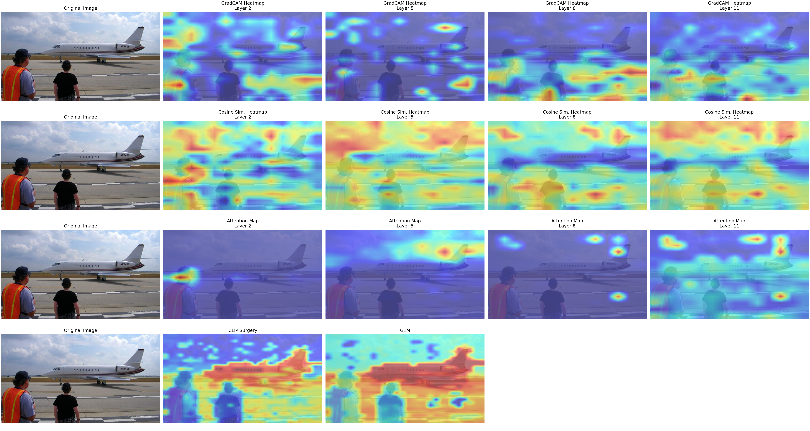
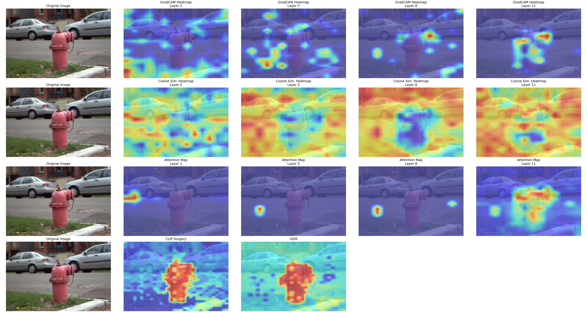
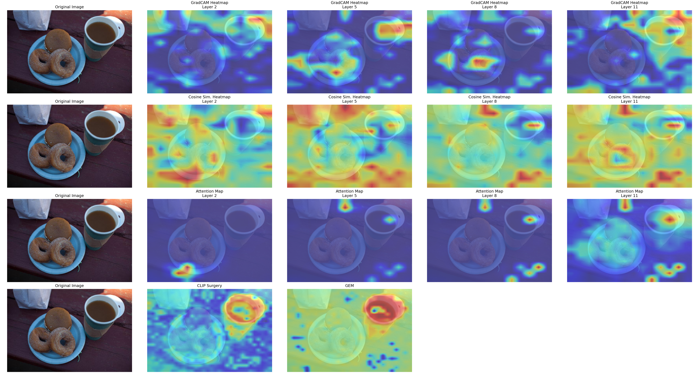

# CLIP Grounding Visualization

This project probes where a CLIP vision transformer "looks" when it matches an image to a text query. A single Jupyter notebook loads OpenAI CLIP ViT-B/16 and produces localization heatmaps for a short caption (for example "jet" or "fire hydrant") with five methods: three implemented directly on CLIP's internals at several transformer depths, and two training-free grounding methods from recent work, CLIP Surgery and GEM. All heatmaps are resized to the input image and assembled into one comparison grid per image.

## Methods

The notebook works on the 14 x 14 patch grid of ViT-B/16 and inspects transformer blocks 3, 6, 9 and 12 (`layer_indices = [2, 5, 8, 11]`).

1. **GradCAM on image-text similarity.** Forward and backward hooks on the `ln_1` LayerNorm of the chosen block capture activations and gradients of the cosine similarity between the image and text embeddings. Gradients are averaged over patches to weight each feature dimension, and the weighted activations are summed, passed through ReLU and normalized.
2. **Patch-feature cosine similarity.** `get_patch_features` re-runs the visual transformer (patch embedding, class token, positional embedding, `ln_pre`), takes the token sequence after the chosen block, drops the class token, applies `ln_post` and the visual projection, and computes the cosine similarity of every patch with the text embedding.
3. **Attention from an anchor patch.** The patch most similar to the text is used as an anchor. `get_attention_map` recomputes Q, K and V from the block's `in_proj` weights, forms the softmax attention matrix averaged over heads, and plots the anchor's attention to all other patches. The anchor patch is outlined in red.
4. **CLIP Surgery.** Uses the `CS-ViT-B/16` model and `clip_feature_surgery` from the CLIP Surgery code at 512 x 512 input, with a "background" prompt alongside the target caption, since feature surgery needs more than one prompt to work.
5. **GEM (Grounding Everything Module).** Uses `gem.create_gem_model` with the OpenAI ViT-B/16 weights and returns a per-pixel heatmap for the caption.

## Results

The repository includes the executed notebook (`src/clip_interpretation_output.ipynb`) and a comparison grid for each of the three image-text pairs in [`src/results/`](src/results/). Each grid has four rows, each starting with the original image: GradCAM at the four layers, cosine similarity at the four layers, anchor-patch attention at the four layers (anchor patch in red), and CLIP Surgery and GEM side by side.

**"jet"** (`src/images/jet_people.jpg`)



In this grid, the per-layer GradCAM and cosine-similarity maps are scattered across the background and the anchor-patch attention maps highlight only a few isolated patches, while CLIP Surgery and GEM place their strongest responses along the aircraft.

**"fire hydrant"** (`src/images/fire_hydrant_car.jpg`)



**"drink"** (`src/images/drink_donut.jpg`)



## Repository structure

```
.
├── src/
│   ├── clip_interpretation.ipynb          notebook with all five methods
│   ├── clip_interpretation_output.ipynb   executed copy with rendered outputs
│   ├── images/                            three input images
│   ├── results/                           comparison grids, <image>_grid.png
│   ├── requirements.txt                   pinned Python dependencies
│   ├── run.sh                             SLURM batch script that executes the notebook
│   └── third_party/CLIP_Surgery/          location expected for the CLIP Surgery code
└── src-snapshot.zip                       archived copy of src/, including the CLIP Surgery code
```

## Setup

The notebook was run with Python 3.10 and a CUDA GPU (it also selects CPU when CUDA is unavailable).

```bash
conda create -n clip-grounding python=3.10
conda activate clip-grounding
pip install -r src/requirements.txt
```

`requirements.txt` pins `torch==2.9.1`, `torchvision==0.24.1`, `open-clip-torch==2.23.0`, `opencv-python`, `matplotlib`, `pillow` and `numpy`. The `open-clip-torch` version is chosen to be compatible with GEM.

Two external components are needed:

- **CLIP Surgery.** The notebook imports `from third_party.CLIP_Surgery.clip import clip`, so the code from [xmed-lab/CLIP_Surgery](https://github.com/xmed-lab/CLIP_Surgery) must be present at `src/third_party/CLIP_Surgery`. In this repository that path is an empty submodule pointer (an archived copy of the code is inside `src-snapshot.zip`), so clone it in place:

  ```bash
  git clone https://github.com/xmed-lab/CLIP_Surgery.git src/third_party/CLIP_Surgery
  ```

- **GEM.** The notebook imports `gem`, which is not listed in `requirements.txt`. Install it following the instructions in [WalBouss/GEM](https://github.com/WalBouss/GEM).

CLIP weights are downloaded automatically by `open_clip` and CLIP Surgery on first use.

## Usage

Run the notebook from inside `src/`, since image and output paths are relative to that folder:

```bash
cd src
jupyter notebook clip_interpretation.ipynb
```

Select the image-text pair by setting `data_index` in the data cell (`"0"` fire hydrant, `"1"` jet, `"2"` drink), then run all cells. The last cell saves the 4 x 5 comparison grid as `src/results/<image>_grid.png`.

To execute the notebook headlessly (this is what `src/run.sh` does as a SLURM job):

```bash
cd src
jupyter nbconvert --to notebook --execute clip_interpretation.ipynb \
    --output clip_interpretation_output.ipynb \
    --ExecutePreprocessor.timeout=3600
```

## Acknowledgements

- CLIP ViT-B/16 (OpenAI weights) loaded through [open_clip](https://github.com/mlfoundations/open_clip).
- [CLIP Surgery](https://github.com/xmed-lab/CLIP_Surgery) for the `CS-ViT-B/16` model, `clip_feature_surgery` and `get_similarity_map`.
- [GEM: Grounding Everything Module](https://github.com/WalBouss/GEM) for the GEM heatmaps.
- The GradCAM method follows Grad-CAM (Selvaraju et al., ICCV 2017), applied here to CLIP's image-text similarity.
